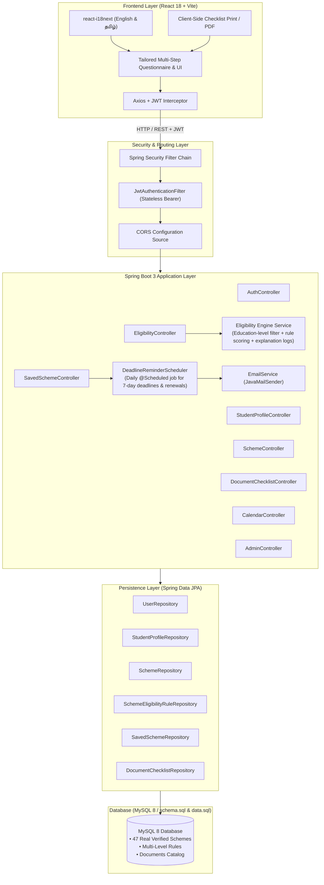

# Student Scholarship and Education Scheme Finder & Application Assistant

[](https://spring.io/projects/spring-boot)
[](https://adoptium.net)
[](https://react.dev)
[](https://vitejs.dev)
[](https://www.mysql.com)
[](http://localhost:8080/swagger-ui.html)

A centralized, production-grade web platform empowering Indian students across all educational stages—**School (Primary, Middle, Secondary, Higher Secondary)**, **Diploma / ITI**, **Undergraduate**, **Postgraduate**, and **Doctoral Research**—to discover welfare schemes, fee waivers, scholarships, education loans, and skill courses (Central Government & Tamil Nadu State Government).

---

## 🏛 System Architecture



---

## 🚀 Key Features

1. **All 8 Education Levels Supported**:
   - `SCHOOL_PRIMARY` (Classes 1–5): CM Breakfast Scheme, Free Uniform & Kit.
   - `SCHOOL_MIDDLE` (Classes 6–8): National Means-cum-Merit (NMMSS), Minorities Pre-Matric.
   - `SCHOOL_SECONDARY` (Classes 9–10): Pre-Matric SC/ST, PM YASASVI, DEPwD Disability.
   - `SCHOOL_HIGHER_SECONDARY` (Classes 11–12): TN Free Bicycle, TN Free Laptop, CBSE Single Girl Child.
   - `DIPLOMA / ITI`: Post-Matric SC/ST & BC/MBC Diploma, AICTE Pragati, AICTE Saksham, Naan Mudhalvan ITI.
   - `UNDERGRADUATE`: Pudhumai Penn (TN girls), Tamil Pudhalvan (TN boys), First Graduate Fee Concession, INSPIRE-SHE, AICTE Pragati, Vidya Lakshmi Loan.
   - `POSTGRADUATE`: UGC Indira Gandhi Single Girl Child, AICTE GATE/GPAT Scholarship, Top Class SC, Dr. Ambedkar Interest Subsidy.
   - `RESEARCH (PhD / MPhil)`: UGC-NET JRF, CSIR-NET JRF, Maulana Azad National Fellowship (MANF), National Fellowship for SC/ST/OBC, PMRF.

2. **Smart Eligibility Rule Engine**:
   - Level-first filtering guarantees zero irrelevant results.
   - Multi-criteria evaluation: Age limits, Family Income Ceiling, Gender, Social Category, Religious Minority, Min Exam Percentage, Institution Type (Govt / Aided / Private), Domicile, Single Girl Child, First Graduate, and Differently-Abled status.
   - Returns a **Match Score (0%–100%)** and granular explanation logs (`✓ Why you match` and `✗ Unmet criteria`).

3. **Kid- & Parent-Friendly School Mode**:
   - Simplified language, large clear controls, and helpful guidance banners indicating that parents or guardians can complete the registration on behalf of young pupils.

4. **Document Readiness Checklist & Printable PDF**:
   - Automatically initializes required certificates upon bookmarking a scheme.
   - Tick and untick document readiness (`isReady`) stored persistently.
   - Single-click print or PDF export for offline submission at colleges or Tahsildar offices.

5. **Scholarship Calendar & Scheduled Deadline Reminders**:
   - Tracks opening windows, closing deadlines, and annual renewal milestones.
   - Daily automated scheduler (`@Scheduled`) alerts users about saved schemes expiring within 7 days and flags renewal requirements.

6. **Bilingual English & தமிழ்**:
   - Instant language switcher powered by `react-i18next`.

---

## 🛠 Tech Stack

- **Backend**: Java 17, Spring Boot 3.2.5, Spring Web, Spring Data JPA, Spring Security (JWT), Spring Validation, Spring Scheduler, JavaMailSender
- **Database**: MySQL 8 (ANSI-SQL `schema.sql` and `data.sql` with 47 preloaded authentic schemes)
- **Frontend**: React 18, Vite 5.2, JavaScript (HTML5/CSS3), React Router v6, Axios, react-i18next, Lucide React icons
- **API Testing**: Postman Collection v2.1.0 (`backend/postman_collection.json`)
- **Documentation**: OpenAPI 3 / Swagger UI (`springdoc-openapi`)
- **Containerization**: Docker Compose (`docker-compose.yml`) for MySQL 8
- **Unit Testing**: JUnit 5, Mockito (21 comprehensive test cases covering all education levels)

---

## 📁 Project Structure

```text
d:\Government Schemes/
├── backend/
│   ├── pom.xml
│   ├── src/
│   │   ├── main/
│   │   │   ├── java/com/scholarship/finder/
│   │   │   │   ├── config/             # SecurityConfig, JwtTokenProvider, OpenApiConfig
│   │   │   │   ├── controller/         # Auth, Profile, Scheme, Eligibility, Saved, Checklist, Calendar, Admin
│   │   │   │   ├── dto/                # Request/Response models & ApiResponse wrapper
│   │   │   │   ├── entity/             # JPA Entities (User, Profile, Scheme, Rules, Documents)
│   │   │   │   ├── exception/          # GlobalExceptionHandler, Custom Exceptions
│   │   │   │   ├── repository/         # Spring Data JPA Repositories
│   │   │   │   ├── scheduler/          # DeadlineReminderScheduler
│   │   │   │   ├── service/            # EligibilityEngine, SchemeService, ProfileService, etc.
│   │   │   │   └── FinderApplication.java
│   │   │   └── resources/
│   │   │       ├── application.properties # Environment variables placeholders
│   │   │       ├── schema.sql          # DDL tables script
│   │   │       └── data.sql            # 47 Real Central & Tamil Nadu schemes
│   │   └── test/
│   │       └── java/com/scholarship/finder/service/EligibilityEngineTest.java # 21 Unit Tests
├── frontend/
│   ├── package.json
│   ├── vite.config.js
│   ├── index.html
│   └── src/
│       ├── api/axios.js                # Axios instance & JWT Bearer interceptor
│       ├── assets/styles.css           # Modern accessible CSS
│       ├── components/                 # Navbar, Footer, SchemeCard, ProtectedRoute
│       ├── context/AuthContext.jsx     # Auth state management
│       ├── i18n/                       # English & Tamil JSON dictionaries
│       ├── pages/                      # Home, Questionnaire, Results, Details, Calendar, Tracker, Checklist, Profile, Admin, Login, Register
│       ├── App.jsx
│       └── main.jsx
└── README.md
```

---

## ⚙️ Setup and Installation

### Prerequisites
- **Java 17 JDK** or higher
- **Maven 3.9+**
- **Node.js 18+** & npm
- **MySQL Server 8.0+**

### 1. Database Setup
You can run a local MySQL 8 instance or start the provided Docker Compose service:
```bash
docker compose up -d mysql
```
Or create the database manually:
```sql
CREATE DATABASE scholarship_db CHARACTER SET utf8mb4 COLLATE utf8mb4_unicode_ci;
```
The application will automatically execute `schema.sql` and `data.sql` on startup to seed the 47 schemes, documents, and rules.

### Postman API Testing
Import `backend/postman_collection.json` into Postman. It includes preconfigured environment variables, automatic token extraction, and end-to-end requests for Authentication, Student Profile, Schemes Catalog, Eligibility Scoring, Application Tracker, Document Checklist, and Reminders.

### 2. Backend Setup
Configure your environment variables or update `backend/src/main/resources/application.properties`:
```properties
SPRING_DATASOURCE_URL=jdbc:mysql://localhost:3306/scholarship_db?useSSL=false&serverTimezone=UTC&allowPublicKeyRetrieval=true&createDatabaseIfNotExist=true
SPRING_DATASOURCE_USERNAME=root
SPRING_DATASOURCE_PASSWORD=root
JWT_SECRET=404E635266556A586E3272357538782F413F4428472B4B6250645367566B5970
SPRING_MAIL_USERNAME=scholarship.finder.alert@gmail.com
SPRING_MAIL_PASSWORD=your_mail_app_password
```

Compile and run tests:
```powershell
cd backend
mvn clean test
mvn spring-boot:run
```
The backend starts at `http://localhost:8080`.
- **Swagger API Docs**: `http://localhost:8080/swagger-ui.html`
- **OpenAPI JSON**: `http://localhost:8080/api-docs`

### 3. Frontend Setup
```powershell
cd frontend
npm install
npm run dev
```
The application starts at `http://localhost:5173`.

---

## 🔐 Default Demo Accounts

| Role | Email | Password | Description |
| :--- | :--- | :--- | :--- |
| **Administrator** | `admin@scholarshipfinder.gov.in` | `Admin@123` | Full CRUD on schemes, rules, documents, and manual reminder dispatch |
| **Demo Student** | `kavitha@example.com` | `User@123` | Undergraduate student with saved tracker items |
| **Demo Student** | `arun@example.com` | `User@123` | School / Diploma student |

---

## 📡 API Endpoints Reference

### Authentication (`/api/auth`)
- `POST /api/auth/register` - Create student or admin account
- `POST /api/auth/login` - Authenticate and obtain JWT token
- `GET /api/auth/me` - Get current authenticated user details

### Student Profile (`/api/profile`)
- `GET /api/profile/me` - Retrieve current student profile
- `POST /api/profile` - Create or update profile

### Schemes Catalog (`/api/schemes`)
- `GET /api/schemes` - List all schemes or filter by keyword, educationLevel, benefitType, state
- `GET /api/schemes/{id}` - Get scheme details including rules and required certificates

### Eligibility Engine (`/api/eligibility`)
- `POST /api/eligibility/evaluate` - Score any profile against scheme rules (guest or logged-in)
- `GET /api/eligibility/my-matches` - Evaluate logged-in student's saved profile

### Saved Schemes & Tracker (`/api/saved-schemes`)
- `GET /api/saved-schemes` - List bookmarked schemes for student
- `POST /api/saved-schemes/{schemeId}` - Save scheme and initialize checklist
- `PATCH /api/saved-schemes/{schemeId}/status` - Update status (`Saved`, `In Progress`, `Applied`, `Approved`, `Rejected`)
- `DELETE /api/saved-schemes/{schemeId}` - Remove from tracker

### Document Checklist (`/api/checklist`)
- `GET /api/checklist` - Get all document checklist items for user
- `GET /api/checklist/scheme/{schemeId}` - Get checklist for specific scheme
- `PUT /api/checklist/{schemeId}/{documentId}` - Toggle document readiness (`isReady: true/false`)

### Calendar (`/api/calendar`)
- `GET /api/calendar` - Timeline of openings, closing deadlines, and annual renewals

### Admin Management (`/api/admin`)
- `POST /api/admin/schemes` - Create scheme with rules and education levels
- `PUT /api/admin/schemes/{id}` - Update scheme
- `DELETE /api/admin/schemes/{id}` - Delete scheme
- `GET /api/admin/documents` - List all document definitions
- `POST /api/admin/documents` - Create master document
- `POST /api/admin/reminders/trigger` - Manually trigger 7-day closing and renewal reminder email job

---

## 🧪 Unit Testing Suite

The eligibility engine is verified with 21 JUnit 5 test cases (`EligibilityEngineTest.java`):
- **School Primary**: CM Breakfast scheme eligible in Government school; ineligible in Private school.
- **School Middle**: NMMSS merit-cum-means test; mark cutoff boundary test.
- **School Secondary**: Pre-Matric SC/ST income limits; Begum Hazrat Mahal minority girls eligibility.
- **School Higher Secondary**: CBSE Single Girl Child scholarship; TN Free Bicycle scheme.
- **Diploma / ITI**: AICTE Pragati girls diploma; AICTE Saksham disability requirement.
- **Undergraduate**: TN Pudhumai Penn scheme for govt school girls; TN Tamil Pudhalvan for boys; First Graduate tuition waiver; INSPIRE-SHE science cutoff.
- **Postgraduate**: UGC Indira Gandhi Single Girl Child; AICTE GATE scholarship.
- **Research**: UGC-NET JRF; National Fellowship for SC Research Scholars.

---

## 📸 Screenshots & User Workflows

1. **Home Page**:
   - Interactive level cards with instant links to School, Diploma, UG, PG, and Research questionnaires.
   - Quick search bar and statistics highlighting Central and TN initiatives.
2. **Adaptive Questionnaire**:
   - Questions change automatically based on education level.
   - Kid/parent-friendly note on school levels.
3. **Smart Results**:
   - Match score badges (Green `>= 80%`, Yellow `50%-79%`, Red `< 50%`).
   - Collapsible breakdown detailing every matched rule and unmet condition.
4. **Document Checklist**:
   - Checklist grouping documents by scheme with ready/pending toggles.
   - Print-ready clean layout for physical verification.
5. **Admin Operations**:
   - Instant addition and removal of schemes and master document definitions.
   - Direct execution of scheduled reminder email batches.

---

## 🔮 Future Improvements

1. **DigiLocker Integration**: Direct API integration with DigiLocker to auto-verify Aadhaar, Community, and Marksheet documents without manual upload.
2. **SMS & WhatsApp Alerts**: Integration with SMS gateways (NIC SMS) and WhatsApp Business API for instant deadline reminders.
3. **Offline Progressive Web App (PWA)**: Support offline questionnaire completion for students in rural areas with low network bandwidth.
4. **AI Scholarship Assistant Chatbot**: Natural language bot answering questions about application eligibility in English and Tamil.

